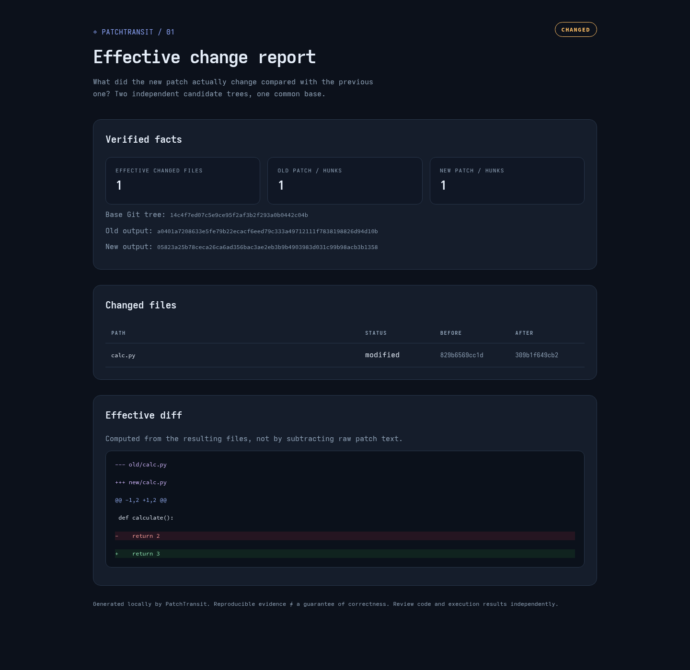

# PatchTransit

[](https://github.com/simonkkz/PatchTransit/actions/workflows/ci.yml)
[](https://www.python.org/)
[](LICENSE)

**See what changed between two revisions of a patch — in the resulting code, not just in the patch text.**



*Example of the standalone evidence report generated locally from a demo repository.*

A 40-file diff gets updated after review. Did it fix the race, change a test, or accidentally delete part of the API? Comparing the two `.patch` files as text is noisy: hunks shift, context moves, line numbers change. PatchTransit applies **both** revisions to separate copies of the **same Git base tree**, then compares the files that actually result.

```text
               Git tree at HEAD
                /            \
          old.patch        new.patch
              |                |
        candidate A      candidate B
              \                /
                effective diff
                       |
              JSON / HTML proof
```

- Works with Git patch files (`git diff > changes.patch`), including text and binary changes.
- Never checks out, stages, rebases, or modifies your working repository.
- Highlights newly added, removed, and changed effects between patch revisions, including executable-mode changes on POSIX systems.
- Optional test command runs separately on **both** candidate trees, with explicit opt-in.
- Generates a standalone HTML report, machine-readable JSON, and a traditional unified diff.
- No LLM, API key, account, service, telemetry, or runtime Python dependencies.

## 30-second quickstart

Requires **Python 3.11+** and **Git**.

```bash
git clone https://github.com/simonkkz/PatchTransit.git
cd PatchTransit
python -m venv .venv
. .venv/bin/activate
python -m pip install -e .

# Generate a tiny, temporary example repository and report:
bash examples/demo.sh
```

For your own repository:

```bash
patchtransit compare previous.patch revised.patch \
  --repo /path/to/project \
  --base HEAD \
  --html report.html --json evidence.json --diff effective.patch
```

`report.html` opens offline in any browser. It contains no external scripts or tracking pixels.

### Verify a single patch against a base

```bash
patchtransit verify changes.patch --repo . --base HEAD --html change.html
```

### Run a test against both versions

```bash
patchtransit compare before.patch after.patch --repo . \
  --command 'python -m unittest discover -s tests' --execute \
  --timeout 120 --json proof.json
```

`--execute` is deliberately required. The command is parsed into an argument vector and run without an intermediate shell. **It still executes arbitrary repository code under your user account.** Review the repository, its dependencies and the command; use an actual container/VM for untrusted inputs. PatchTransit is *not* a sandbox.

A `regression` verdict means the old command exited successfully and the new command did not. An `improvement` means the new command exited successfully and the old did not. The tool does **not** claim that one successful test is a formal proof of correctness.

### Inspect patch metadata

```bash
patchtransit inspect before.patch
```

## What is actually compared?

The output is determined by the full file state after applying each patch, not by subtraction of patch text. Executable permission changes are represented as mode metadata on platforms that preserve POSIX file modes; mode-only changes may not be observable on Windows filesystems. For every changed file, the JSON records the path, change type and SHA-256 digest of both versions. Plain UTF-8 changes, including file additions and deletions, appear as Git-applicable unified diffs. Binary/large-file changes are represented by their checksums rather than complete patches. The readable diff preview is capped at 16,000 lines or 8 MiB; when truncated, the JSON `changes` manifest still includes **every** changed file.

The **common base tree matters**. Patches based on different commits should be rebased onto a common base before comparing them. PatchTransit refuses to compare a revision that fails to apply cleanly.

`--base HEAD` inspects committed content only, even when your current working tree contains unrelated local changes. Your dirty files and index remain untouched. The tool creates disposable copies under your system temporary directory, so you need enough free disk space for two copies of that Git tree.

## CLI reference

| Command | Purpose |
|---|---|
| `patchtransit inspect PATCH` | Metadata: paths, hunks, additions/deletions, SHA-256 |
| `patchtransit compare OLD NEW` | Compare two patch revisions on the same base |
| `patchtransit verify PATCH` | Compare a patch with unchanged base |
| `--repo DIR` | Repository path (default `.`) |
| `--base REF` | Git revision (default `HEAD`) |
| `--json FILE` | Versioned machine-readable result |
| `--html FILE` | Self-contained dark-mode HTML report |
| `--diff FILE` | Effective unified diff |
| `--command CMD --execute` | Run the same test command on both candidate directories |
| `--timeout N` | Per-command timeout in seconds (default 120) |

Exit codes: `0` for successful comparison with no confirmed regression, `1` if the old test succeeded but the new test failed, `2` for invalid arguments, inapplicable patches or other errors. Without a test command, a `changed` verdict is informational and exits `0`.

## Security and privacy

- The tool never executes the patch itself. The optional `--execute` runs a command in the patched tree and has **no OS sandbox**.
- Reports contain code paths and **diff contents**. Inspect before sharing for proprietary source, personal data, or secrets.
- The JSON records test exit codes, elapsed time and hashes of stdout/stderr. It intentionally does **not** copy raw test logs or environment variables into evidence. Command output is captured in temporary files and hashed in chunks rather than accumulated in process memory. Temporary files are deleted after each check, and each output stream has a 64 MiB safety cap.
- Committed Git blobs are copied directly from the immutable tree with path, symlink, file-size and total-size checks. Git archive `export-ignore` attributes cannot silently omit tracked files. Git submodule entries are currently rejected explicitly, and missing blobs in partial clones cause a local error rather than a network fetch.
- Patch paths undergo safety checks; Git itself validates whether a patch applies. Simple renames work; unusual multi-path encodings that cannot be parsed safely are rejected.
- Every CLI test should be considered a normal execution of project code with your privileges.

See [SECURITY.md](SECURITY.md) for threat model and disclosure instructions.

## Why not `git range-diff`?

[`git range-diff`](https://git-scm.com/docs/git-range-diff) compares **commit series** and is the right tool for iterative commit review. PatchTransit focuses on two standalone `.patch` files applied to a common base, compares their **complete resulting file trees**, and optionally executes the same verification command against each result. It complements rather than replaces Git.

## Continuous integration and maintenance

GitHub Actions runs Ruff lint/format, strict Pyrefly type checks on `src/`, and integration tests on Linux, macOS and Windows across Python 3.11–3.15. A separate workflow measures branch coverage on `main`, saves the XML report as a GitHub Actions artifact, and attempts an OIDC-authenticated upload to Codecov. Codecov outages do not block the test matrix. Renovate configuration in `renovate.json` tracks Python dev tool versions and GitHub Actions; automated update PRs require enabling the Renovate GitHub App for the repository.

## Development

```bash
python -m venv .venv && . .venv/bin/activate
python -m pip install -e '.[dev]'
ruff check src tests
ruff format --check src tests
pyrefly check
python -m unittest discover -s tests -v
bash examples/demo.sh
```

Python standard library + Git only. See [CONTRIBUTING.md](CONTRIBUTING.md).

## License

MIT. See [LICENSE](LICENSE).
